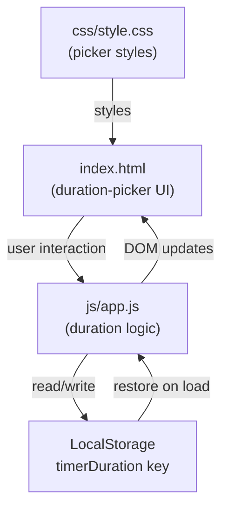
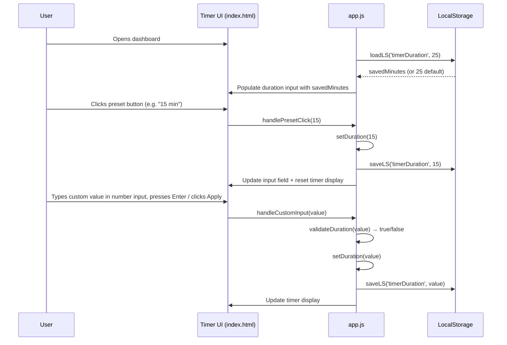

# Design Document: Custom Pomodoro Timer

## Overview

Allow users to change the Focus Timer duration from the hardcoded 25 minutes to any value between 1 and 120 minutes, with a few preset options and a free-form number input. The chosen duration is persisted in LocalStorage so it survives page reloads.

## Architecture

The feature is entirely client-side. No new files or external dependencies are introduced. Changes are confined to the three existing files:



The duration-picker UI sits inside the existing `#timer-card` section. No new cards or top-level components are added.

## Components and Interfaces

### Component 1: Duration Picker UI

**Purpose**: Lets the user select a preset or type a custom duration before (or after) resetting the timer.

**Interface** (DOM elements):

```javascript
// Preset buttons — one per entry in PRESETS array
// <button class="btn-preset" data-minutes="{n}">{n} min</button>

// Custom input + apply button
const durationInput    = document.getElementById('duration-input');   // <input type="number">
const btnApplyDuration = document.getElementById('btn-apply-duration');
```

**Responsibilities**:
- Render preset buttons from the `PRESETS` constant
- Reflect the active duration visually (`.active` class on the matching preset button)
- Accept free-form numeric input and validate before applying
- Delegate actual duration changes to `setDuration()`

---

### Component 2: Duration State (app.js additions)

**Purpose**: Owns the mutable `focusMinutes` / `focusSeconds` variables and exposes functions to change, validate, and persist the duration.

**Interface**:

```javascript
// Public-facing functions (called by event handlers)
function loadDuration()            // called once at startup
function validateDuration(value)   // → boolean
function setDuration(minutes)      // applies + persists a valid duration
function syncDurationUI(minutes)   // keeps picker UI in sync
function handlePresetClick(event)  // event handler for .btn-preset buttons
function handleCustomApply()       // event handler for #btn-apply-duration
```

**Responsibilities**:
- Load and default the duration from LocalStorage
- Validate user input before applying
- Keep `focusMinutes`, `focusSeconds`, and `secondsLeft` in sync
- Persist chosen duration to LocalStorage
- Reset the running timer when duration changes

## Data Models

### Model 1: Stored Duration

```javascript
// LocalStorage key: 'timerDuration'
// Value type: number (integer)
{
  timerDuration: number   // minutes, integer, 1 ≤ value ≤ 120
}
```

**Validation Rules**:
- Must be a whole number (no decimals)
- Minimum value: 1 (minute)
- Maximum value: 120 (minutes)
- Stored as a plain JSON number via `JSON.stringify`

---

### Model 2: Preset Definition

```javascript
// Constant array — not persisted, defined in app.js
const PRESETS = [5, 10, 15, 25, 45, 60]; // minutes (integers)
```

**Validation Rules**:
- Each entry must satisfy the same [1, 120] range rule
- Entries are rendered as `.btn-preset` buttons in order

## Main Algorithm / Workflow



## Core Interfaces / Types

```javascript
/**
 * Shape stored in LocalStorage under key 'timerDuration'.
 * Plain integer — minutes only.
 * @type {number}  1 ≤ timerDuration ≤ 120
 */

// Preset options rendered as buttons
const PRESETS = [5, 10, 15, 25, 45, 60]; // minutes

// Replaces the current hardcoded constant:
// const FOCUS_SECONDS = 25 * 60;
// New runtime variable:
let focusMinutes = 25;          // loaded from LS or default
let focusSeconds = focusMinutes * 60;  // derived, reset on duration change
```

## Key Functions with Formal Specifications

### `loadDuration()`

```javascript
function loadDuration() {
  focusMinutes = loadLS('timerDuration', 25);
  focusSeconds = focusMinutes * 60;
}
```

**Preconditions:**
- `loadLS` is available and `localStorage` is accessible
- Stored value (if present) was previously validated before saving

**Postconditions:**
- `focusMinutes` is an integer in range [1, 120]
- `focusSeconds === focusMinutes * 60`
- If no stored value exists, defaults to 25

**Loop Invariants:** N/A

---

### `validateDuration(value)`

```javascript
/**
 * @param {*} value  — raw value from input element
 * @returns {boolean}
 */
function validateDuration(value) {
  const n = parseInt(value, 10);
  return Number.isInteger(n) && n >= 1 && n <= 120;
}
```

**Preconditions:**
- `value` is any value (may be string, number, NaN, null)

**Postconditions:**
- Returns `true` if and only if `parseInt(value, 10)` is a whole number in [1, 120]
- Returns `false` for fractions, negatives, zero, strings, null, undefined, NaN
- No mutations to any external state

**Loop Invariants:** N/A

---

### `setDuration(minutes)`

```javascript
/**
 * @param {number} minutes  — already validated integer in [1, 120]
 */
function setDuration(minutes) {
  focusMinutes = minutes;
  focusSeconds = minutes * 60;
  secondsLeft  = focusSeconds;   // reset countdown to new duration
  saveLS('timerDuration', minutes);
  resetTimer();                  // stop + re-render display
  syncDurationUI(minutes);       // highlight active preset, set input value
}
```

**Preconditions:**
- `validateDuration(minutes) === true`
- Timer is NOT in the middle of a running session (caller must stop first, or setDuration auto-resets)
- `resetTimer` and `syncDurationUI` are defined

**Postconditions:**
- `focusMinutes === minutes`
- `focusSeconds === minutes * 60`
- `secondsLeft === focusSeconds`
- LocalStorage key `'timerDuration'` holds `minutes`
- Timer display shows the new duration (e.g. "10:00")
- Preset buttons reflect the active selection

**Loop Invariants:** N/A

---

### `syncDurationUI(activeMinutes)`

```javascript
/**
 * Updates the preset buttons (active state) and the custom input field.
 * @param {number} activeMinutes
 */
function syncDurationUI(activeMinutes) {
  document.querySelectorAll('.btn-preset').forEach(btn => {
    btn.classList.toggle('active', parseInt(btn.dataset.minutes, 10) === activeMinutes);
  });
  durationInput.value = activeMinutes;
}
```

**Preconditions:**
- DOM contains elements with class `btn-preset` and `data-minutes` attribute
- `durationInput` references `<input id="duration-input">`

**Postconditions:**
- Exactly one `.btn-preset` has class `active` if `activeMinutes` matches a preset value; none if custom
- `durationInput.value` equals `String(activeMinutes)`
- No changes to timer state or LocalStorage

**Loop Invariants:**
- For each button iterated: `active` class is correct after `classList.toggle`

---

### `handlePresetClick(event)`

```javascript
/**
 * Event handler attached to each preset button.
 * @param {MouseEvent} event
 */
function handlePresetClick(event) {
  const minutes = parseInt(event.currentTarget.dataset.minutes, 10);
  if (timerRunning) stopTimer();
  setDuration(minutes);
}
```

**Preconditions:**
- `event.currentTarget.dataset.minutes` contains a valid integer string in [1, 120]

**Postconditions:**
- If timer was running, it is stopped before duration changes
- `setDuration` is called with the correct integer value

---

### `handleCustomApply()`

```javascript
/**
 * Called when user clicks "Apply" button or presses Enter in the custom input.
 */
function handleCustomApply() {
  const raw = durationInput.value;
  if (!validateDuration(raw)) {
    durationInput.classList.add('input-error');
    return;
  }
  durationInput.classList.remove('input-error');
  if (timerRunning) stopTimer();
  setDuration(parseInt(raw, 10));
}
```

**Preconditions:**
- `durationInput` references `<input id="duration-input">`
- `validateDuration` is defined

**Postconditions:**
- If `raw` is invalid: `input-error` class added, no state changes, function returns early
- If `raw` is valid: timer reset to new duration, error class removed, duration persisted

---

## Algorithmic Pseudocode

### Duration Change Flow

```pascal
PROCEDURE handleDurationChange(source, value)
  INPUT: source ∈ {preset, custom}, value (integer or raw string)
  OUTPUT: side-effects (DOM update, LS save)

  BEGIN
    IF source = preset THEN
      minutes ← value   // already an integer from data-minutes
    ELSE
      IF NOT validateDuration(value) THEN
        markInputError(durationInput)
        RETURN
      END IF
      minutes ← parseInt(value, 10)
    END IF

    IF timerRunning THEN
      stopTimer()
    END IF

    setDuration(minutes)
  END
END PROCEDURE
```

**Preconditions:**
- `source` is either `"preset"` or `"custom"`
- `timerRunning` reflects the actual timer state

**Postconditions:**
- On valid input: timer is stopped (if running), duration is updated, UI and LS are synced
- On invalid custom input: error is shown, no state change occurs

**Loop Invariants:** N/A

---

## Example Usage

```javascript
// ── On page load ──────────────────────────────────────────
loadDuration();           // focusMinutes = 25 (or saved value)
renderTimer();            // shows "25:00" (or saved duration)
syncDurationUI(focusMinutes);

// ── User clicks the "15 min" preset button ────────────────
// <button class="btn-preset" data-minutes="15">15 min</button>
// → handlePresetClick fires
//   timerRunning is false → skip stopTimer
//   setDuration(15) → focusMinutes=15, secondsLeft=900
//   timer display updates to "15:00"
//   "15 min" button gets .active class
//   LS['timerDuration'] = 15

// ── User types "45" in the custom input and clicks Apply ──
// handleCustomApply()
//   validateDuration("45") → true
//   setDuration(45) → focusMinutes=45, secondsLeft=2700
//   timer display updates to "45:00"
//   no preset button is active (45 is not in PRESETS list)
//   LS['timerDuration'] = 45

// ── User types "200" in the custom input and clicks Apply ─
// handleCustomApply()
//   validateDuration("200") → false (> 120)
//   input gets .input-error class, nothing else changes
```

---

## HTML Changes (index.html)

The timer card gains a duration-picker row above the controls:

```html
<!-- inside #timer-card, above .timer-controls -->
<div class="duration-picker">
  <button class="btn-preset" data-minutes="5">5 min</button>
  <button class="btn-preset" data-minutes="10">10 min</button>
  <button class="btn-preset" data-minutes="15">15 min</button>
  <button class="btn-preset" data-minutes="25">25 min</button>
  <button class="btn-preset" data-minutes="45">45 min</button>
  <button class="btn-preset" data-minutes="60">60 min</button>
</div>
<div class="duration-custom-row">
  <input type="number" id="duration-input" min="1" max="120" placeholder="1–120" />
  <span class="duration-label">min</span>
  <button id="btn-apply-duration">Apply</button>
</div>
```

---

## CSS Changes (style.css)

```css
/* Duration picker — preset buttons */
.duration-picker {
  display: flex;
  flex-wrap: wrap;
  gap: 6px;
  justify-content: center;
  margin-bottom: 12px;
}

.btn-preset {
  background: #edf2f7;
  color: #4a5568;
  padding: 5px 10px;
  font-size: 0.8rem;
  border-radius: 6px;
}

.btn-preset:hover { background: #e2e8f0; }

.btn-preset.active {
  background: #667eea;
  color: #fff;
}

/* Custom duration input row */
.duration-custom-row {
  display: flex;
  align-items: center;
  gap: 8px;
  justify-content: center;
  margin-bottom: 16px;
}

#duration-input {
  width: 64px;
  padding: 6px 8px;
  border: 2px solid #e2e8f0;
  border-radius: 8px;
  font-size: 0.9rem;
  text-align: center;
  outline: none;
}

#duration-input:focus { border-color: #667eea; }

#duration-input.input-error { border-color: #e53e3e; }

.duration-label { font-size: 0.9rem; color: #718096; }

#btn-apply-duration { background: #667eea; color: #fff; }
#btn-apply-duration:hover { background: #5a67d8; }

/* Dark mode additions */
body.dark .btn-preset {
  background: #3d3d5c;
  color: #cbd5e0;
}

body.dark .btn-preset:hover { background: #4a4a6a; }

body.dark .btn-preset.active {
  background: #667eea;
  color: #fff;
}

body.dark #duration-input {
  background: #2d2d44;
  border-color: #4a4a6a;
  color: #e2e8f0;
}
```

---

## Error Handling

### Error Scenario 1: Out-of-range custom input

**Condition**: User types a value less than 1, greater than 120, zero, or a non-integer (e.g. "0", "200", "abc", "3.5") in `#duration-input` and clicks Apply.
**Response**: `validateDuration` returns `false`; `input-error` CSS class is added to the input (red border). No duration change occurs.
**Recovery**: User corrects the value; on next valid Apply, `input-error` class is removed and duration is applied.

### Error Scenario 2: Corrupt LocalStorage value

**Condition**: `timerDuration` in LocalStorage holds a non-numeric or out-of-range value (e.g. tampered manually).
**Response**: `loadDuration` reads the raw value; if `validateDuration` fails, the default of 25 minutes is used instead.
**Recovery**: The first valid `setDuration` call overwrites the corrupt entry.

### Error Scenario 3: Duration changed while timer is running

**Condition**: User attempts to change duration while the countdown is active.
**Response**: `handlePresetClick` / `handleCustomApply` call `stopTimer()` before `setDuration()`, ensuring the interval is cleared cleanly.
**Recovery**: Timer resets to the new duration in a stopped state; user can press Start to begin a new session.

## Correctness Properties

### Property 1: Duration range
For any duration `d` saved to LocalStorage via `setDuration`, `1 ≤ d ≤ 120`.

### Property 2: Display consistency
After `setDuration(m)`, `timerDisplay.textContent === formatTime(m * 60)`.

### Property 3: Persistence
After a page reload, `loadDuration()` restores `focusMinutes` to the last value set by `setDuration`.

### Property 4: Running guard
`setDuration` never leaves the timer in a running state; if the timer was running when `setDuration` is called, it is stopped first.

### Property 5: Idempotency
Calling `setDuration(m)` twice with the same `m` produces the same final state as calling it once.

### Property 6: Invalid input rejected
`validateDuration(x)` returns `false` for any `x` outside [1, 120], ensuring no out-of-range duration is ever applied.
